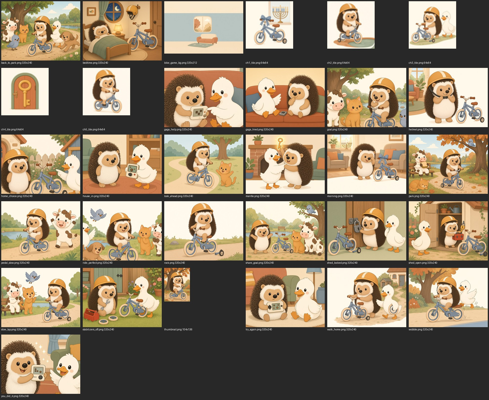
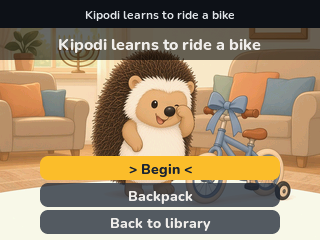
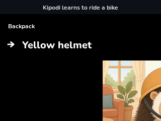
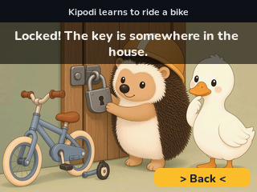
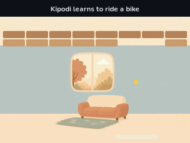
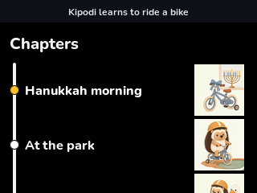

# flam-re

Personal **Flam-native interactive stories** on stock Lunii Flam firmware **2.4.2** — packaging and interop only. No CFW, no catalog rip, no device keys in this repo.

Goal: original homebrew that uses the same device features as commercial packs (choices, session backpack, chapter map, in-story mini-games), plus notes so others can ship their own stories via PRs to [`stories/`](stories/).

## Achievements (fw 2.4.2, device-proven)

| Milestone | What |
|-----------|------|
| **fw2 mint** | Personal packs install without recovering the device AES key. On-disk `key` = SNU32; cipher `info` / `*.lsf` under `.mdf` C0/C1. Write-up: [`docs/fw2-key-wrap.md`](docs/fw2-key-wrap.md) |
| **Audio lifecycle** | Single-track host audio; `priority = true` on scene enter; never `requestAudioStop(true, true)` in scene `clean()`. Guide: [`docs/authoring-full-story.md`](docs/authoring-full-story.md) |
| **Session backpack** | In-memory table on `Global.*` + `list-choice` UI (no host `backpack.*`). Proven on Lost Button; used in Kipodi bike |
| **Chapter map** | `Global.progression` + `chapterView` (product Map). Canary-proven; French confirm dialog from shipped runtime. RE: [`docs/map-backpack-re.md`](docs/map-backpack-re.md) |
| **In-story game** | Box Breaker mini-game embedded in Kipodi bike (2 losses → GaGa help path) |
| **Example stories** | [`stories/lost-button/`](stories/lost-button/) (short feature demo) · [`stories/kipodi-learns-to-ride-a-bike/`](stories/kipodi-learns-to-ride-a-bike/) (full interactive open-source example) |

Upstream mint thread: [Flam.RE #1](https://github.com/o-daneel/Flam.RE/issues/1#issuecomment-6552957337). Runtime / build skill: [scarlaty/flam-player](https://github.com/scarlaty/flam-player) `skills/flam-homebrew`.

## Screenshots — Kipodi learns to ride a bike

<p align="center">
  
</p>

| Title | Backpack | Shed locked |
|:-----:|:--------:|:-----------:|
|  |  |  |
| **Box Breaker** | **Chapters** | |
|  |  | |

**Synopsis (six beats):** Hanukkah-morning bike → rock snaps a stabilizer → locked shed vs house → Box Breaker (2 losses → GaGa help) → key / toolbox / stabilizers off → wobble choices → pond ride → bedtime. **25 scenes**, ~9 min narration, **5 chapter-map chapters**. v2 darker paddle/ball art. Simulator: 9 routes OK; device: launch + chapter tiles OK (French chapter confirm from firmware UI).

## Constraints

- **Packaging / interop only** — no CFW, no firmware flashing, no hardware exploits
- **No catalog prose/audio** — dummy or original assets only; never redistribute official Flam/Lunii story content
- Tools read `.mdf` / SNU from a **mounted personal device** at runtime; this repo does **not** ship device secrets or raw `.mdf` dumps

## Layout

```text
docs/                 Mint, authoring, RE notes
docs/media/           README screenshots
flamtool/             Host mint/pack helpers (Python + pycryptodome)
stories/              Community + example homebrew (see stories/README.md)
  lost-button/        Short original feature demo
  kipodi-learns-to-ride-a-bike/   Full open-source example (+ dist .plain.pk)
requirements.txt
```

## How to pack (fw 2.4.2)

1. Build or obtain a `.plain.pk` (flam-homebrew / [flam-player](https://github.com/scarlaty/flam-player), or use a shipped `stories/*/dist/*.plain.pk`).
2. Mount the Flam USB (VFAT). Confirm `$FLAM_ROOT/.mdf` exists.
3. Install:

```bash
python3 -m venv .venv && . .venv/bin/activate
pip install -r requirements.txt
python flamtool/pack.py "$FLAM_ROOT" /path/to/story.plain.pk
sync
# udisksctl unmount + power-off; power-cycle Flam into the library
```

Bare single-Lua mint: `flamtool/mint.py` (prefer `pack.py` for real modules). Cleanup test UUIDs: `flamtool/cleanup.py`.

Longer loop: [`docs/author-mint-play.md`](docs/author-mint-play.md).  
**Full interactive authoring** (audio, backpack, chapter map, mini-games, checklist): [`docs/authoring-full-story.md`](docs/authoring-full-story.md).

## Contribute a story

PRs welcome under [`stories/`](stories/) — original / clearly licensed content only. Start from [`stories/README.md`](stories/README.md) and the Kipodi bike example.

## Docs index (high signal)

| Doc | Topic |
|-----|-------|
| [`fw2-key-wrap.md`](docs/fw2-key-wrap.md) | Solved personal mint model |
| [`authoring-full-story.md`](docs/authoring-full-story.md) | Full interactive story guide + ship checklist |
| [`map-backpack-re.md`](docs/map-backpack-re.md) | Map / backpack / chapterView recipes |
| [`flam-fw2-technical-guide.md`](docs/flam-fw2-technical-guide.md) | fw 2.4.2 digest (FS, audio host, sandbox) |
| [`author-mint-play.md`](docs/author-mint-play.md) | Mount → pack → play |
| [`lost-button.md`](docs/lost-button.md) | Short device-proven sample |
| [`flam-native-lsf.md`](docs/flam-native-lsf.md) | On-disk pack shape |
| [`project-context.md`](docs/project-context.md) | Project status overview |

## License / provenance

Research and original tooling by [Yariminal](https://github.com/Yariminal). Official Flam/Lunii firmware and catalog content remain their owners’. Homebrew under `stories/` is original unless a story README says otherwise.
